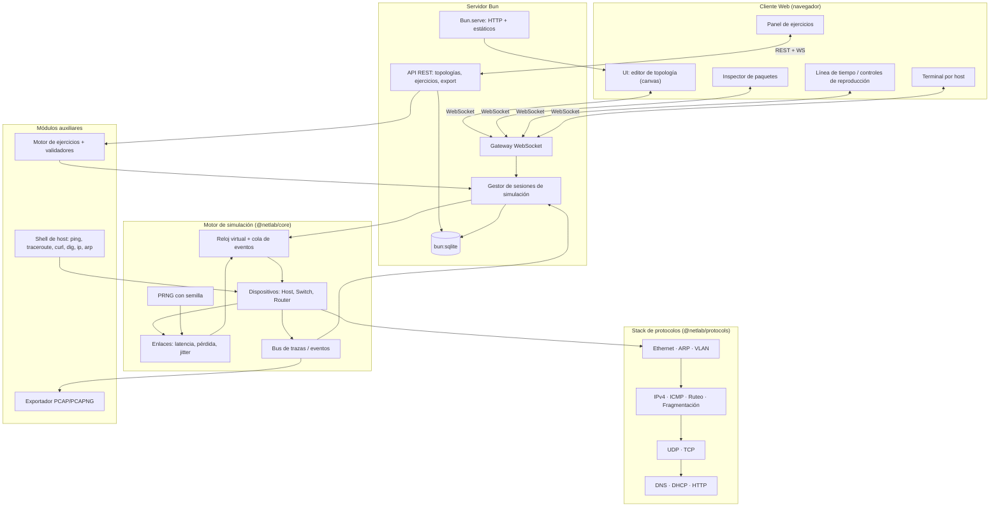
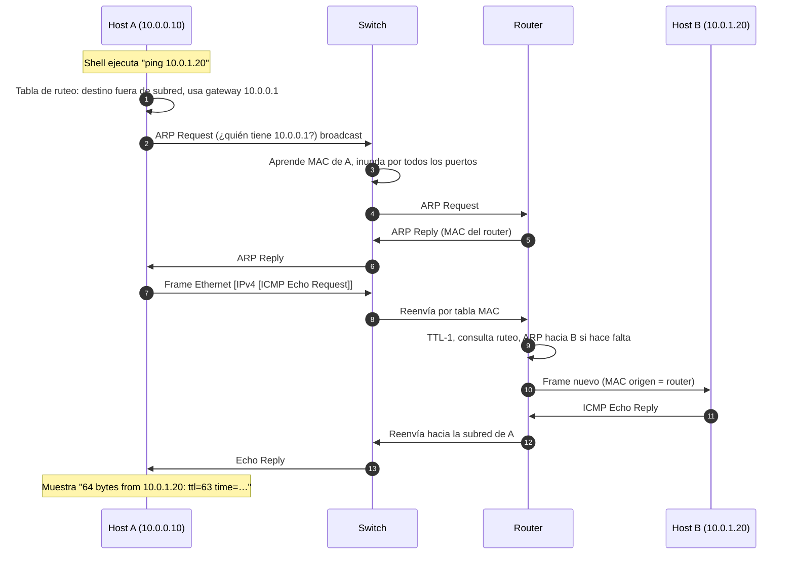
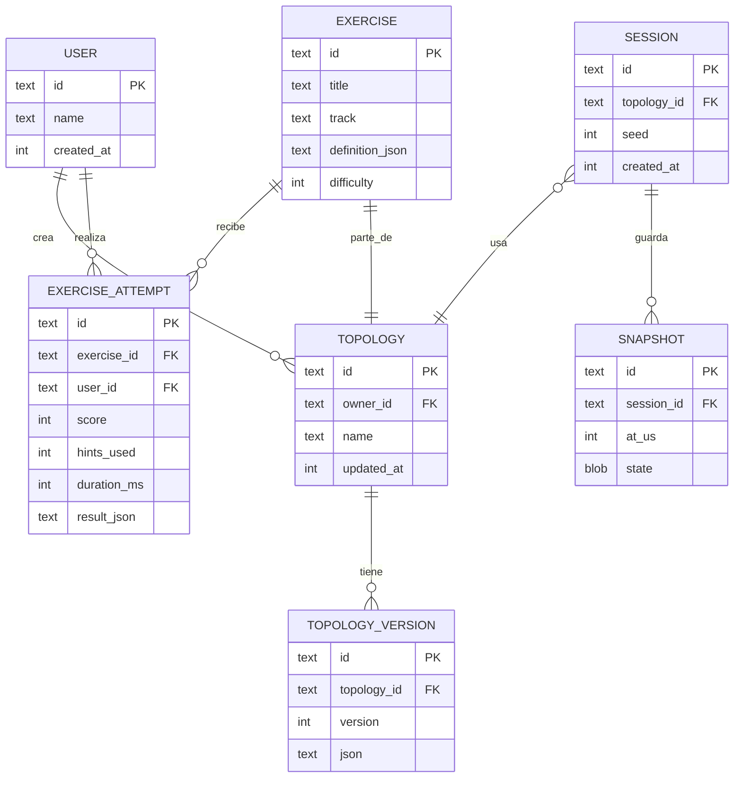
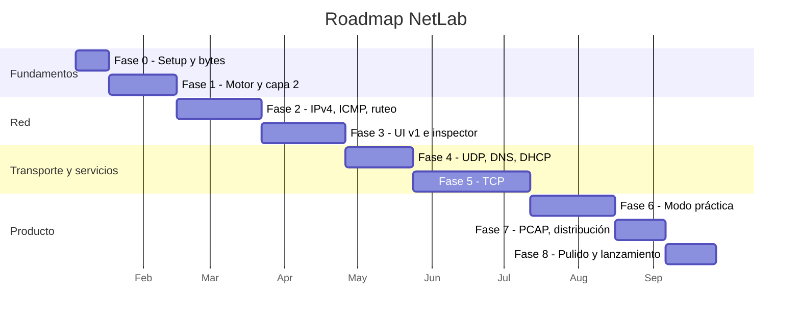

# NetLab — Laboratorio de redes interactivo con stack TCP/IP propio

> Roadmap, arquitectura y especificación funcional. Runtime: **Bun**. Lenguaje: **TypeScript**.

---

## Índice

1. [Visión y objetivos](#1-visión-y-objetivos)
2. [Alcance](#2-alcance)
3. [Arquitectura propuesta](#3-arquitectura-propuesta)
4. [Diseño del motor de simulación](#4-diseño-del-motor-de-simulación)
5. [Especificación funcional detallada](#5-especificación-funcional-detallada)
6. [Protocolo cliente-servidor (WebSocket)](#6-protocolo-cliente-servidor-websocket)
7. [Modelo de datos y persistencia](#7-modelo-de-datos-y-persistencia)
8. [Roadmap por fases](#8-roadmap-por-fases)
9. [Estrategia de testing](#9-estrategia-de-testing)
10. [Requisitos no funcionales](#10-requisitos-no-funcionales)
11. [Estructura del repositorio](#11-estructura-del-repositorio)
12. [Decisiones de diseño (ADRs a escribir)](#12-decisiones-de-diseño-adrs-a-escribir)
13. [Riesgos y mitigaciones](#13-riesgos-y-mitigaciones)
14. [Plan de portafolio y distribución](#14-plan-de-portafolio-y-distribución)
15. [Ideas de extensión](#15-ideas-de-extensión)
16. [Referencias](#16-referencias)

---

## 1. Visión y objetivos

**NetLab** es un simulador de redes en el que los protocolos **no se fingen**: cada dispositivo virtual implementa de verdad los protocolos sobre **frames binarios** (`Uint8Array`). Un ping dentro de la simulación genera un frame Ethernet real, con un paquete IPv4 real y un mensaje ICMP real, con checksums correctos.

### Objetivos

| #   | Objetivo                                                | Cómo se mide                                                         |
| --- | ------------------------------------------------------- | -------------------------------------------------------------------- |
| O1  | Aprender redes implementando los protocolos desde cero  | Cada protocolo tiene tests contra vectores del RFC o capturas reales |
| O2  | Visualizar cómo viaja un paquete capa por capa          | Inspector de paquetes con cada header desglosado                     |
| O3  | Practicar con ejercicios que se validan automáticamente | Al menos 25 ejercicios con corrección automática                     |
| O4  | Demostrar corrección con herramientas reales            | Capturas `.pcap` exportadas se abren en Wireshark sin errores        |
| O5  | Proyecto de portafolio sólido                           | Demo pública, benchmarks, documentación, binario descargable         |

### Público objetivo

- Estudiantes de redes (CCNA, ingeniería, tecnicaturas).
- Desarrolladores que quieren entender TCP/IP por dentro.
- Reclutadores e ingenieros que evalúan el portafolio.

### Principios de diseño

1. **Determinismo:** misma topología + misma semilla = misma ejecución. Permite reproducir bugs y validar ejercicios.
2. **Bytes primero:** toda la comunicación entre dispositivos es binaria. Nada de pasar objetos entre nodos.
3. **Tiempo virtual:** el reloj de la simulación es independiente del reloj real.
4. **Núcleo sin dependencias:** el stack de protocolos corre en cualquier entorno JS (Bun, navegador, Node).
5. **Observabilidad total:** cada evento relevante emite un registro inspeccionable.

---

## 2. Alcance

### Dentro del alcance (MVP y versión 1.0)

- Capa 2: Ethernet II, switch con aprendizaje de MAC, ARP, VLANs 802.1Q (access/trunk).
- Capa 3: IPv4, ICMP, ruteo estático, fragmentación y reensamblado, TTL.
- Capa 4: UDP y TCP (handshake, ventana deslizante, retransmisión, control de congestión básico).
- Capa 7: DNS, DHCP y HTTP/1.1 mínimos.
- Condiciones de enlace: latencia, jitter, pérdida, reordenamiento, duplicación, corte.
- UI web: editor de topología, consola por host, inspector de paquetes, línea de tiempo.
- Modo práctica con ejercicios y validadores.
- Exportación `.pcap` / `.pcapng`.
- Persistencia de topologías, escenarios y progreso.

### Fuera del alcance (inicial)

- IPv6 completo (queda como extensión).
- Protocolos de ruteo dinámico complejos (OSPF, BGP). RIP sí, como extra.
- TLS real (puede aparecer como extensión).
- Emulación de hardware real de fabricantes (CLI estilo Cisco completa).
- Multiusuario en tiempo real (extensión).

---

## 3. Arquitectura propuesta

### 3.1 Vista general (diagrama de componentes)



### 3.2 Flujo de un paquete (diagrama de secuencia)

Ejemplo: `ping 10.0.1.20` desde el host A a un host B en otra subred, atravesando un switch y un router.



### 3.3 Capas del software

| Capa                | Paquete             | Responsabilidad                                                             | Depende de                       |
| ------------------- | ------------------- | --------------------------------------------------------------------------- | -------------------------------- |
| Utilidades binarias | `@netlab/bytes`     | Lectura/escritura de buffers, checksums, helpers de direcciones (MAC, IPv4) | nada                             |
| Protocolos          | `@netlab/protocols` | Parsers y serializadores, máquinas de estado (ARP cache, TCP, etc.)         | `bytes`                          |
| Motor               | `@netlab/core`      | Reloj virtual, cola de eventos, enlaces, dispositivos, trazas               | `protocols`, `bytes`             |
| Shell               | `@netlab/shell`     | Comandos tipo Linux ejecutables dentro de un host                           | `core`                           |
| Ejercicios          | `@netlab/exercises` | Definición de escenarios, validadores, puntaje                              | `core`                           |
| Captura             | `@netlab/pcap`      | Escritura de PCAP/PCAPNG a partir de trazas                                 | `bytes`                          |
| Servidor            | `@netlab/server`    | HTTP, WebSocket, sesiones, persistencia                                     | todos los anteriores             |
| Web                 | `@netlab/web`       | UI                                                                          | protocolo WS (tipos compartidos) |
| CLI                 | `@netlab/cli`       | Ejecutar escenarios sin interfaz, benchmarks, replay                        | `core`, `exercises`              |

**Regla de dependencias:** las flechas apuntan solo hacia abajo. `protocols` nunca importa `core`; `core` nunca importa `server`.

### 3.4 Decisiones tecnológicas

| Aspecto                | Elección                                                       | Motivo                                                                              |
| ---------------------- | -------------------------------------------------------------- | ----------------------------------------------------------------------------------- |
| Runtime                | Bun                                                            | `Bun.serve` con WebSockets nativos, `bun:sqlite`, `bun test`, `bun build --compile` |
| Lenguaje               | TypeScript estricto                                            | Tipos para headers y mensajes WS compartidos                                        |
| UI                     | Vite o `Bun.build` + framework liviano (Svelte, Solid o React) | Reactividad para el inspector y la línea de tiempo                                  |
| Canvas                 | SVG o Canvas 2D (considerar Pixi.js si hay muchos nodos)       | Topologías chicas o medianas                                                        |
| Persistencia           | `bun:sqlite`                                                   | Cero dependencias, archivo único                                                    |
| Validación de mensajes | Esquemas propios o Zod                                         | Contrato claro cliente-servidor                                                     |
| Distribución           | `bun build --compile`                                          | Ejecutable único con la UI embebida                                                 |

### 3.5 Dónde corre la simulación

Se propone un **motor isomórfico**: el mismo `@netlab/core` puede correr en el servidor o directamente en el navegador (Web Worker).

- **Modo servidor (por defecto):** el motor corre en Bun, la UI es cliente liviano. Permite sesiones compartidas y ejercicios validados en el servidor.
- **Modo local (extensión):** el motor corre en un Web Worker del navegador y la app funciona sin backend (por ejemplo para publicar una demo estática).

Esto se logra evitando APIs específicas de Bun dentro de `core`, `protocols` y `bytes`.

---

## 4. Diseño del motor de simulación

### 4.1 Reloj virtual y cola de eventos

- Tiempo en **microsegundos** como `bigint` o `number` (con cuidado de precisión).
- Cola de prioridad (min-heap) ordenada por `(timestamp, secuencia)`. La secuencia desempata para mantener determinismo.
- Tipos de evento: `FrameDelivery`, `TimerFired`, `LinkStateChange`, `UserAction`, `ShellCommand`.
- Modos de ejecución: **tiempo real** (factor de velocidad configurable), **paso a paso**, **salto al siguiente evento**, **ejecución instantánea** (para tests y validación).

```ts
interface SimEvent {
  at: number; // µs de tiempo virtual
  seq: number; // desempate determinista
  run(sim: Simulation): void;
}

class Simulation {
  now = 0;
  schedule(delayUs: number, fn: (sim: Simulation) => void): TimerHandle {
    /* ... */
  }
  step(): boolean {
    /* procesa el próximo evento */
  }
  runUntil(untilUs: number): void {
    /* ... */
  }
}
```

### 4.2 Modelo de dispositivos

Todo dispositivo es un conjunto de **interfaces** (puertos) conectadas a **enlaces**.

```ts
interface Interface {
  name: string; // "eth0"
  mac: MacAddress;
  up: boolean;
  receive(frame: Uint8Array): void; // llamada por el enlace
  send(frame: Uint8Array): void; // entrega al enlace
}

abstract class Device {
  id: string;
  interfaces: Interface[];
  abstract onFrame(iface: Interface, frame: Uint8Array): void;
}
```

| Dispositivo                               | Comportamiento                                                                                  |
| ----------------------------------------- | ----------------------------------------------------------------------------------------------- |
| **Host**                                  | Stack completo: ARP, IPv4, ICMP, UDP, TCP, sockets simulados, shell, DNS resolver, cliente DHCP |
| **Switch**                                | Tabla MAC con envejecimiento, inundación, VLANs, trunks, contadores por puerto                  |
| **Router**                                | Reenvío IPv4, tabla de ruteo, ARP por interfaz, TTL, ICMP de error, NAT (extensión)             |
| **Hub** (didáctico)                       | Repite todo por todos los puertos; sirve para mostrar colisiones y diferencias con el switch    |
| **Servidor de servicios** (host con apps) | Host con DNS, DHCP o HTTP configurados                                                          |

### 4.3 Enlaces

Cada enlace conecta dos interfaces y aplica un modelo de condiciones por dirección:

| Parámetro       | Descripción                                                        |
| --------------- | ------------------------------------------------------------------ |
| `latencyUs`     | Retardo base de propagación                                        |
| `jitterUs`      | Variación aleatoria (distribución uniforme o normal)               |
| `lossRate`      | Probabilidad de descarte (0 a 1)                                   |
| `burstLoss`     | Modelo Gilbert-Elliott para pérdidas en ráfagas                    |
| `reorderRate`   | Probabilidad de reordenar paquetes                                 |
| `duplicateRate` | Probabilidad de duplicar                                           |
| `corruptRate`   | Probabilidad de alterar bits (para probar checksums)               |
| `bandwidthBps`  | Ancho de banda: tiempo de serialización más cola con tamaño máximo |
| `mtu`           | Tamaño máximo de frame (dispara fragmentación)                     |
| `up`            | Enlace caído o levantado                                           |

El PRNG es **seedable** (por ejemplo `xoshiro128**` o `mulberry32`) y se comparte vía la simulación, nunca `Math.random()`.

### 4.4 Sistema de trazas

Cada evento significativo emite una **traza** estructurada:

```ts
type Trace =
  | {
      t: number;
      kind: "frame_tx";
      device: string;
      iface: string;
      frame: Uint8Array;
    }
  | {
      t: number;
      kind: "frame_rx";
      device: string;
      iface: string;
      frame: Uint8Array;
    }
  | {
      t: number;
      kind: "frame_drop";
      where: string;
      reason: DropReason;
      frame: Uint8Array;
    }
  | { t: number; kind: "state"; device: string; layer: string; detail: unknown } // p. ej. cambio de estado TCP
  | { t: number; kind: "log"; device: string; level: string; msg: string };
```

Consumidores: inspector de la UI, exportador PCAP, validadores de ejercicios, tests.

### 4.5 Pipeline de procesamiento en un host

```
Interface.receive(frame)
  └─ Ethernet.parse → ¿MAC destino mía/broadcast/multicast?
       ├─ EtherType 0x0806 → ARP.handle
       └─ EtherType 0x0800 → IPv4.parse (checksum, TTL, fragmentos)
            ├─ ¿destino mío? no → descartar (host) / reenviar (router)
            └─ protocolo
                 ├─ 1  → ICMP.handle
                 ├─ 6  → TCP.handle (demultiplexa por 4-tupla)
                 └─ 17 → UDP.handle (demultiplexa por puerto)
                          └─ Aplicaciones (DNS, DHCP, HTTP, usuario)
```

Envío es el camino inverso: aplicación → socket → TCP/UDP → IPv4 (ruteo, fragmentación) → ARP (resolver MAC, encolar mientras espera) → Ethernet → interfaz.

---

## 5. Especificación funcional detallada

Cada funcionalidad incluye un identificador (`F-xx`) para trazarla en el roadmap y los tests.

### 5.1 Utilidades binarias (`@netlab/bytes`)

| ID   | Funcionalidad                   | Detalle                                                                                                     |
| ---- | ------------------------------- | ----------------------------------------------------------------------------------------------------------- |
| F-01 | `BufferReader` / `BufferWriter` | Lectura y escritura big-endian de u8, u16, u32; cursor; slices sin copia; errores claros por truncamiento   |
| F-02 | Direcciones                     | Tipos `MacAddress`, `Ipv4Address`, `Cidr` con parseo, formato, comparación, aritmética de máscaras          |
| F-03 | Checksums                       | Checksum de Internet (RFC 1071) incremental; pseudo-header para TCP/UDP; CRC32 para FCS Ethernet (opcional) |
| F-04 | Hexdump                         | Formateo estilo Wireshark para el inspector                                                                 |

### 5.2 Capa 2

**Ethernet (F-10 a F-13)**

- F-10: Parseo y serialización de Ethernet II (destino, origen, EtherType, payload).
- F-11: Padding a 60 bytes mínimos y FCS opcional.
- F-12: Filtrado por MAC en la interfaz (unicast propio, broadcast, multicast suscripto, modo promiscuo).
- F-13: Contadores por interfaz (rx/tx frames, bytes, errores, descartes).

**Switch (F-14 a F-18)**

- F-14: Aprendizaje de MAC por puerto de origen, con envejecimiento (aging time configurable).
- F-15: Reenvío unicast conocido, inundación de unknown-unicast y broadcast (excluyendo el puerto de entrada).
- F-16: Tabla MAC visible en UI y por comando (`show mac-table`).
- F-17: VLANs 802.1Q: puertos access y trunk, etiquetado y desetiquetado, VLAN nativa, aislamiento entre VLANs.
- F-18 (extensión): STP simplificado para evitar bucles, con visualización de puertos bloqueados.

**ARP (F-19 a F-22)**

- F-19: Request y Reply con parseo y serialización.
- F-20: Caché ARP con TTL, estados (incompleto, alcanzable, obsoleto) y reintentos.
- F-21: Cola de paquetes pendientes mientras se resuelve la MAC, con límite y timeout (`host unreachable`).
- F-22: Gratuitous ARP y detección simple de IP duplicada. Ejercicio de ARP spoofing en modo laboratorio.

### 5.3 Capa 3

**IPv4 (F-30 a F-36)**

- F-30: Parseo y serialización del header (versión, IHL, ToS/DSCP, longitud, ID, flags, offset, TTL, protocolo, checksum, direcciones, opciones ignoradas pero preservadas).
- F-31: Validación: checksum, longitud, versión, TTL. Descarte con razón registrada.
- F-32: Tabla de ruteo con longest prefix match; rutas conectadas, estáticas y por defecto; métricas.
- F-33: Fragmentación según MTU del enlace de salida y respeto del bit DF.
- F-34: Reensamblado con buffer por `(src, dst, id, proto)`, timeout y límite de memoria.
- F-35: Reenvío en router: decremento de TTL, recálculo de checksum, ICMP Time Exceeded.
- F-36: Configuración de interfaces (IP, máscara, gateway) por UI, shell y DHCP.

**ICMP (F-37 a F-40)**

- F-37: Echo Request/Reply (base de `ping`).
- F-38: Destination Unreachable (red, host, puerto, fragmentación necesaria con DF).
- F-39: Time Exceeded (base de `traceroute`).
- F-40: Redirect (extensión, con ejercicio asociado).

**Ruteo dinámico (extensión)**

- F-41: RIP v2: vector de distancia, split horizon, poison reverse, timers, convergencia visible. Ejercicio de "conteo al infinito".

**NAT (extensión)**

- F-42: NAT/PAT en router con tabla de traducciones visible, timeouts y reenvío de puertos.

### 5.4 Capa 4

**UDP (F-50 a F-52)**

- F-50: Parseo, serialización y checksum con pseudo-header.
- F-51: Sockets UDP simulados (`bind`, `sendTo`, `recvFrom`) y demultiplexación por puerto.
- F-52: ICMP Port Unreachable al recibir datagramas para puertos cerrados.

**TCP (F-53 a F-62)**

- F-53: Parseo y serialización de segmentos (flags, seq, ack, ventana, opciones MSS/WS/SACK/TS).
- F-54: Máquina de estados completa (CLOSED, LISTEN, SYN_SENT, SYN_RECEIVED, ESTABLISHED, FIN_WAIT_1/2, CLOSE_WAIT, CLOSING, LAST_ACK, TIME_WAIT) con visualización del diagrama en vivo.
- F-55: Handshake de tres vías y cierre de cuatro vías, incluyendo RST y conexiones simultáneas.
- F-56: Buffers de envío y recepción, numeración de secuencia con wraparound.
- F-57: Ventana deslizante con control de flujo (ventana anunciada, zero window probes).
- F-58: Retransmisión: RTO calculado con RTT suavizado (RFC 6298), backoff exponencial, retransmisión rápida por tres ACK duplicados.
- F-59: Control de congestión: slow start, congestion avoidance, fast recovery (Reno). Gráfico en vivo de `cwnd` y `ssthresh`.
- F-60 (extensión): SACK y Cubic como algoritmo alternativo intercambiable.
- F-61: API de sockets simulados (`listen`, `accept`, `connect`, `send`, `recv`, `close`) con promesas.
- F-62: Reordenamiento y segmentos fuera de orden: buffer de reensamblado y ACKs duplicados.

### 5.5 Capa 7

| ID               | Servicio            | Detalle                                                                                                                           |
| ---------------- | ------------------- | --------------------------------------------------------------------------------------------------------------------------------- |
| F-70             | DNS (cliente)       | Resolver con caché y TTL, consultas A/AAAA/CNAME/MX/TXT/NS, compresión de nombres, reintentos, fallback a TCP si hay truncamiento |
| F-71             | DNS (servidor)      | Zonas autoritativas editables desde la UI, respuestas con flags AA/RD/RA, NXDOMAIN, recursión opcional                            |
| F-72             | DHCP (servidor)     | DORA completo, pools, reservas, lease time, opciones (gateway, DNS, máscara)                                                      |
| F-73             | DHCP (cliente)      | Estados INIT, SELECTING, REQUESTING, BOUND, RENEWING, REBINDING; configuración automática de interfaz                             |
| F-74             | HTTP/1.1 (servidor) | Rutas estáticas configurables, códigos de estado, headers, keep-alive, contenido por archivo virtual                              |
| F-75             | HTTP/1.1 (cliente)  | `GET/POST/HEAD`, redirecciones, `Content-Length` y `chunked`                                                                      |
| F-76 (extensión) | TLS educativo       | Handshake simplificado visible paso a paso (no criptografía de producción)                                                        |

### 5.6 Shell del host (`@netlab/shell`)

Cada host tiene una terminal en la UI con comandos que usan el stack real de la simulación.

| Comando                                              | Funcionalidad                                                 |
| ---------------------------------------------------- | ------------------------------------------------------------- |
| `ip addr`, `ip link`, `ip route`                     | Ver y modificar configuración (set, add, del)                 |
| `ping [-c n] [-s size] [-t ttl] dst`                 | ICMP Echo con estadísticas (min/avg/max, pérdida)             |
| `traceroute dst`                                     | Basado en TTL creciente e ICMP Time Exceeded                  |
| `arp -a`, `ip neigh`                                 | Ver y borrar caché ARP                                        |
| `nslookup` / `dig`                                   | Consultas DNS con salida detallada                            |
| `curl` / `wget`                                      | Cliente HTTP                                                  |
| `nc` (netcat)                                        | Conexiones TCP/UDP interactivas, modo escucha                 |
| `ss` / `netstat`                                     | Sockets y estados TCP                                         |
| `tcpdump [-i iface] [filtro]`                        | Captura en vivo dentro del host con filtros BPF simplificados |
| `dhclient`                                           | Obtener IP por DHCP                                           |
| `hostname`, `cat /etc/hosts`, `cat /etc/resolv.conf` | Configuración básica                                          |
| `help`, `man <cmd>`                                  | Ayuda integrada con teoría breve                              |

Características: historial, autocompletado, cancelación con Ctrl+C (envía señal al proceso simulado), salida en streaming.

### 5.7 Interfaz web

**Editor de topología (F-80 a F-86)**

- F-80: Lienzo con arrastrar y soltar de dispositivos (host, switch, router, hub, servidor).
- F-81: Conexión de interfaces por cables; validación (no conectar dos puntas a la misma interfaz).
- F-82: Panel de propiedades por dispositivo (nombre, interfaces, IP, VLAN, rutas, servicios).
- F-83: Panel de propiedades por enlace (parámetros de la sección 4.3) con presets: "LAN ideal", "WiFi inestable", "Satélite", "Enlace WAN congestionado".
- F-84: Deshacer/rehacer, copiar y pegar, alinear, zoom y desplazamiento.
- F-85: Importar y exportar topología en JSON versionado.
- F-86: Plantillas de topologías (LAN simple, dos subredes con router, red con VLANs, red con DMZ).

**Visualización del tráfico (F-87 a F-91)**

- F-87: Animación de frames viajando por los cables, con color por protocolo.
- F-88: Marcadores de eventos: descartes (con razón), colisiones del hub, retransmisiones.
- F-89: Resaltado de la ruta seguida por un paquete seleccionado.
- F-90: Vista de tablas en vivo: MAC, ARP, ruteo, conexiones TCP, NAT.
- F-91: Gráficos en vivo: `cwnd`, RTT, throughput por enlace, ocupación de cola.

**Inspector de paquetes (F-92 a F-96)**

- F-92: Lista cronológica de frames con columnas (tiempo, origen, destino, protocolo, longitud, resumen).
- F-93: Filtro por expresión (por ejemplo `ip.src == 10.0.0.10 && tcp.flags.syn`).
- F-94: Detalle por capas expandible; clic en un campo resalta los bytes correspondientes en el hexdump y viceversa.
- F-95: Seguimiento de flujo TCP (Follow TCP stream) y diagrama de secuencia (flow graph) generado automáticamente.
- F-96: Explicación didáctica por campo ("TTL: cuántos saltos más puede dar el paquete").

**Control de la simulación (F-97 a F-100)**

- F-97: Reproducir, pausar, paso a evento, paso a paquete, velocidad ajustable.
- F-98: Línea de tiempo con scrub: retroceder a cualquier instante (se logra por replay determinista desde snapshots periódicos).
- F-99: Puntos de interrupción: "pausar cuando un paquete cumpla X" o "cuando TCP pase a estado Y".
- F-100: Inyección de fallas manual: cortar un cable, reiniciar un dispositivo, borrar caché ARP, enviar un frame crafteado.

**Constructor de paquetes (F-101)**

- F-101: Formulario por capas para crear y enviar un frame arbitrario desde un host (útil para laboratorios de seguridad y de errores).

### 5.8 Modo práctica

**Motor de ejercicios (F-110 a F-116)**

- F-110: Un ejercicio se define de forma declarativa: topología inicial, **fallas preinstaladas**, objetivo, pistas, validadores.
- F-111: Tipos de ejercicio:
  - **Construir:** armar una red que cumpla requisitos.
  - **Configurar:** completar direccionamiento, rutas o VLANs.
  - **Diagnosticar:** encontrar y corregir la falla escondida.
  - **Analizar:** responder preguntas sobre una captura precargada.
  - **Optimizar:** lograr cierto throughput ajustando MTU, ventanas o rutas.
- F-112: Validadores basados en la simulación real: ejecutan pruebas (ping, curl, DNS) y evalúan trazas y estado, no solo configuración.
- F-113: Pistas graduales con penalización de puntaje.
- F-114: Progreso, puntaje, intentos y tiempo por ejercicio.
- F-115: Rutas de aprendizaje (por ejemplo: "Capa 2", "Direccionamiento y ruteo", "TCP a fondo", "Servicios de red").
- F-116: Editor de ejercicios (modo autor) y exportación en JSON para compartir.

**Catálogo inicial sugerido (25 ejercicios)**

| Bloque           | Ejercicios                                                                                                      |
| ---------------- | --------------------------------------------------------------------------------------------------------------- |
| Capa 2           | Aprendizaje del switch; inundación vs hub; VLAN aislada; trunk mal configurado; ARP spoofing                    |
| Direccionamiento | Subnetting básico; VLSM; máscara incorrecta; IP duplicada; gateway faltante                                     |
| Ruteo            | Dos redes con un router; ruta por defecto; bucle de ruteo con TTL; ruta más específica; RIP y convergencia      |
| ICMP/TTL         | Traceroute a mano; MTU y fragmentación; `Fragmentation needed` con DF                                           |
| TCP/UDP          | Handshake paso a paso; retransmisión con pérdida; zero window; congestión con cuello de botella; puerto cerrado |
| Servicios        | DNS roto; DHCP agotado; HTTP con redirección                                                                    |

**Trainer de subnetting (F-117)**

- F-117: Generador de ejercicios aleatorios de CIDR, VLSM, resumen de rutas y cálculo de broadcast/rango útil, con corrección explicada paso a paso.

### 5.9 Exportación y captura

| ID    | Funcionalidad        | Detalle                                                                        |
| ----- | -------------------- | ------------------------------------------------------------------------------ |
| F-120 | Export PCAP          | Formato clásico (libpcap), LINKTYPE_ETHERNET, timestamps de la simulación      |
| F-121 | Export PCAPNG        | Con comentarios, interfaces por dispositivo y nombre de host                   |
| F-122 | Captura por interfaz | Seleccionar dispositivo/interfaz o toda la red                                 |
| F-123 | Import PCAP          | Cargar capturas reales para analizarlas en el inspector (modo "Analizar")      |
| F-124 | Export de escenario  | JSON con topología, semilla y acciones del usuario para reproducir exactamente |
| F-125 | Export de diagrama   | SVG/PNG de la topología y flow graph                                           |

### 5.10 Persistencia y cuentas

- F-130: Guardado automático de topologías y escenarios en `bun:sqlite`.
- F-131: Historial de versiones de una topología.
- F-132: Progreso de ejercicios por usuario (identidad local en el MVP; cuentas opcionales después).
- F-133: Compartir topología por enlace (token de solo lectura).

### 5.11 CLI (`@netlab/cli`)

- `netlab run escenario.json --seed 42 --until 10s`: ejecución sin UI.
- `netlab validate ejercicio.json solucion.json`: validar una solución.
- `netlab replay traza.json`: reproducir eventos.
- `netlab bench`: benchmarks de eventos por segundo y throughput TCP simulado.
- `netlab pcap escenario.json -o salida.pcap`: generar una captura.

---

## 6. Protocolo cliente-servidor (WebSocket)

Mensajes JSON con tipo discriminado. Los frames viajan como base64 o, para eficiencia, en mensajes binarios separados con un header corto.

### 6.1 Cliente → Servidor

```ts
type ClientMsg =
  | { type: "session.create"; topology: TopologyJSON; seed?: number }
  | { type: "session.join"; sessionId: string }
  | {
      type: "sim.control";
      action: "play" | "pause" | "step" | "seek";
      speed?: number;
      toTimeUs?: number;
    }
  | { type: "topo.patch"; ops: TopologyOp[] } // agregar/quitar nodos, cables, configurar
  | { type: "shell.exec"; deviceId: string; line: string }
  | { type: "shell.signal"; deviceId: string; pid: number; signal: "SIGINT" }
  | { type: "fault.inject"; kind: FaultKind; target: string }
  | {
      type: "packet.craft";
      deviceId: string;
      iface: string;
      frame: string /* base64 */;
    }
  | { type: "exercise.start"; exerciseId: string }
  | { type: "exercise.check" };
```

### 6.2 Servidor → Cliente

```ts
type ServerMsg =
  | { type: "sim.state"; nowUs: number; running: boolean; speed: number }
  | { type: "trace.batch"; traces: TraceDTO[] } // lotes cada ~16 ms
  | { type: "tables.update"; deviceId: string; tables: Partial<DeviceTables> }
  | {
      type: "shell.output";
      deviceId: string;
      pid: number;
      chunk: string;
      done?: boolean;
    }
  | {
      type: "exercise.result";
      passed: boolean;
      checks: CheckResult[];
      score: number;
    }
  | { type: "error"; code: string; message: string };
```

### 6.3 Consideraciones

- **Batching:** las trazas se agrupan en ventanas de ~16 ms para no saturar el socket.
- **Backpressure:** si el cliente se retrasa, el servidor degrada (agrega trazas, descarta animaciones) pero conserva siempre el registro completo para el inspector.
- **Versionado:** campo `v` en el handshake para compatibilidad.
- **Seguridad:** límites de tamaño de mensaje, tasa de comandos por sesión y topología máxima (por ejemplo 200 nodos).

---

## 7. Modelo de datos y persistencia



Notas:

- Las topologías se serializan como JSON versionado con migraciones.
- Los snapshots permiten el scrub hacia atrás sin replay completo.
- Las trazas no se persisten por defecto (se regeneran por replay determinista); se pueden guardar en archivo para capturas largas.

---

## 8. Roadmap por fases

Estimaciones para **una persona a tiempo parcial** (10 a 15 h/semana). Si dedicás tiempo completo, dividí los plazos a la mitad aproximadamente.



> Las fechas son orientativas; ajustalas al día de inicio real.

### Fase 0 — Setup y utilidades binarias (≈ 2 semanas)

**Objetivo:** base del monorepo y herramientas de bytes.

**Tareas**

- Monorepo con `bun workspaces`, TypeScript estricto, lint y formato.
- CI con `bun test` y chequeo de tipos.
- `@netlab/bytes`: F-01 a F-04.
- Vectores de prueba para checksum (RFC 1071) y direcciones.
- Documento ADR-001 (monorepo y reglas de dependencias).

**Entregable:** paquete `bytes` con cobertura > 90 %.

**Criterio de aceptación:** los tests de checksum coinciden con ejemplos del RFC y con resultados calculados en una captura real.

### Fase 1 — Motor de simulación y capa 2 (≈ 4 semanas)

**Objetivo:** que dos hosts conectados por un switch intercambien frames.

**Tareas**

- Reloj virtual, cola de eventos determinista, PRNG con semilla.
- Enlaces con latencia, pérdida y jitter (4.3).
- Dispositivos `Host`, `Switch`, `Hub`; interfaces y contadores.
- Ethernet (F-10 a F-13), switch con aprendizaje (F-14 a F-16).
- ARP (F-19 a F-21).
- Sistema de trazas (4.4).
- CLI mínima `netlab run` que carga un JSON y muestra trazas por consola.

**Entregable:** escenario "dos hosts y un switch" donde un host resuelve la MAC del otro y se ve la tabla MAC poblarse.

**Criterios de aceptación**

- Misma semilla produce la misma secuencia de trazas (test de determinismo).
- El switch inunda el primer frame y luego reenvía unicast.
- Cola de ARP pendiente funciona y expira correctamente.

### Fase 2 — Capa 3: IPv4, ICMP y ruteo (≈ 5 semanas)

**Objetivo:** `ping` y `traceroute` entre subredes.

**Tareas**

- IPv4 (F-30 a F-36): parseo, validaciones, tabla de ruteo con LPM.
- Dispositivo `Router` con múltiples interfaces.
- ICMP (F-37 a F-39).
- Fragmentación y reensamblado (F-33, F-34).
- Shell mínima: `ip`, `ping`, `traceroute`, `arp` (primera parte de 5.6).
- VLANs en switch (F-17).

**Entregable:** topología de dos subredes con un router, donde `traceroute` muestra cada salto.

**Criterios de aceptación**

- TTL se decrementa por salto y genera Time Exceeded al llegar a 0.
- Un paquete de 4000 bytes con MTU 1500 se fragmenta y se reensambla en destino.
- Con DF activado se recibe `Fragmentation needed`.
- Bucle de ruteo se corta por TTL (test).

### Fase 3 — UI v1 e inspector de paquetes (≈ 5 semanas)

**Objetivo:** hacer visible todo lo anterior.

**Tareas**

- Servidor `Bun.serve` + WebSocket (sección 6), sesiones.
- Editor de topología (F-80 a F-84).
- Panel de propiedades de dispositivos y enlaces (F-82, F-83).
- Animación de frames (F-87).
- Inspector de paquetes: lista, detalle por capas, hexdump con resaltado bidireccional (F-92, F-94).
- Controles de reproducción y paso a paso (F-97).
- Terminal por host en la UI con la shell de la Fase 2.
- Persistencia básica de topologías (F-130).

**Entregable:** demo navegable donde se arma una red, se hace ping y se inspeccionan los bytes.

**Criterios de aceptación**

- Clic en un campo del header resalta los bytes correctos.
- La animación respeta la latencia configurada del enlace.
- 100 nodos y 1000 frames/segundo sin caída de rendimiento perceptible.

### Fase 4 — UDP y servicios (DNS, DHCP) (≈ 4 semanas)

**Objetivo:** servicios de red reales sobre el stack.

**Tareas**

- UDP y sockets simulados (F-50 a F-52).
- DNS cliente y servidor (F-70, F-71) con compresión de nombres.
- DHCP servidor y cliente (F-72, F-73).
- Comandos `dig`/`nslookup`, `dhclient`, `nc -u`.
- Filtros del inspector (F-93) y flow graph básico (F-95, parte UDP).

**Entregable:** red donde un host obtiene IP por DHCP y resuelve nombres con un DNS propio.

**Criterios de aceptación**

- Mensajes DNS y DHCP generados se decodifican correctamente en Wireshark (verificación manual documentada).
- DHCP renueva leases según temporizadores.

### Fase 5 — TCP (≈ 7 semanas)

**Objetivo:** TCP funcional y observable. Es la fase más difícil; se divide en hitos.

| Hito | Contenido                                                       | Duración    |
| ---- | --------------------------------------------------------------- | ----------- |
| 5.1  | Segmentos, máquina de estados, handshake y cierre (F-53 a F-55) | 1,5 semanas |
| 5.2  | Buffers, envío/recepción ordenados, ACKs acumulativos (F-56)    | 1 semana    |
| 5.3  | Ventana deslizante y control de flujo (F-57)                    | 1 semana    |
| 5.4  | RTO, retransmisión y fast retransmit (F-58)                     | 1,5 semanas |
| 5.5  | Reno: slow start, congestion avoidance, fast recovery (F-59)    | 1 semana    |
| 5.6  | API de sockets, `nc`, `ss`, HTTP sobre TCP (F-61, F-74, F-75)   | 1 semana    |

**Entregable:** transferencia de un archivo de 1 MB entre dos hosts con 5 % de pérdida y reordenamiento, completando con integridad verificada y gráfico de `cwnd`.

**Criterios de aceptación**

- Tests con pérdida y reordenamiento aleatorio (propiedad: los datos recibidos son idénticos a los enviados).
- Handshake y cierre coinciden con el diagrama del RFC 793 / 9293.
- Gráfico de `cwnd` muestra la forma característica (diente de sierra).
- El throughput varía de forma coherente con RTT y pérdida (comparar con la fórmula de Mathis como sanity check).

### Fase 6 — Modo práctica (≈ 5 semanas)

**Objetivo:** convertir el simulador en herramienta de aprendizaje.

**Tareas**

- Formato de definición de ejercicios y validadores (F-110 a F-112).
- Panel de ejercicios en la UI con pistas y puntaje (F-113, F-114).
- Rutas de aprendizaje (F-115).
- Catálogo inicial de 25 ejercicios (sección 5.8).
- Trainer de subnetting (F-117).
- Inyección de fallas (F-100) y constructor de paquetes (F-101).
- `netlab validate` en la CLI.

**Entregable:** al menos 4 rutas de aprendizaje con ejercicios completos y validación automática.

**Criterios de aceptación**

- Cada ejercicio tiene una solución de referencia que pasa el validador y un test que lo verifica en CI.
- Un validador rechaza soluciones "tramposas" (por ejemplo, configurar la IP sin que haya conectividad real).

### Fase 7 — Captura PCAP y distribución (≈ 3 semanas)

**Objetivo:** demostrar corrección con herramientas reales y empaquetar.

**Tareas**

- Exportación PCAP/PCAPNG (F-120 a F-122) e importación (F-123).
- Validación automática: abrir la captura con `tshark` en CI y verificar que no hay malformaciones (`tshark -r out.pcap -q -z expert`).
- Scrub hacia atrás con snapshots (F-98) y breakpoints (F-99).
- Ejecutable único con `bun build --compile` con la UI embebida.
- Exportación de escenarios y diagramas (F-124, F-125).

**Entregable:** binario descargable para Linux, macOS y Windows.

**Criterios de aceptación**

- `tshark` abre capturas de todos los escenarios de ejemplo sin errores ni advertencias de checksum.
- El binario inicia en menos de 1 segundo y no requiere instalación.

### Fase 8 — Pulido, documentación y lanzamiento (≈ 3 semanas)

**Tareas**

- Accesibilidad (teclado, contraste, lectores de pantalla en el inspector).
- Tutorial interactivo de bienvenida.
- Benchmarks publicados (eventos/segundo, memoria, throughput TCP simulado).
- Sitio de documentación con teoría breve por protocolo y enlace a ejercicios.
- Demo pública (modo local en navegador o backend alojado).
- Post técnico: "Implementé TCP desde cero en TypeScript: lo que aprendí".
- Video corto de demostración (60-90 segundos).

**Entregable:** lanzamiento público v1.0.

### Resumen de hitos

| Hito | Contenido | Resultado visible                         |
| ---- | --------- | ----------------------------------------- |
| M1   | Fases 0-1 | Dos hosts y switch intercambian frames    |
| M2   | Fase 2    | `ping` y `traceroute` entre subredes      |
| M3   | Fase 3    | Demo web con inspector de paquetes        |
| M4   | Fases 4-5 | DNS, DHCP, HTTP sobre TCP propio          |
| M5   | Fase 6    | Modo práctica con ejercicios              |
| M6   | Fases 7-8 | Lanzamiento v1.0, binario y documentación |

**Estrategia de entrega temprana:** al terminar la Fase 3 ya hay algo publicable. Subí el repositorio y la demo en ese punto: un proyecto visible a mitad de camino vale más que uno perfecto sin terminar.

---

## 9. Estrategia de testing

| Nivel                  | Qué cubre                                                                                         | Herramientas                                     |
| ---------------------- | ------------------------------------------------------------------------------------------------- | ------------------------------------------------ |
| Unitarios              | Parsers y serializadores, checksums, tablas (MAC, ARP, ruteo)                                     | `bun test`                                       |
| Vectores de referencia | Paquetes de ejemplo de RFCs y capturas reales (fixtures `.pcap`)                                  | `bun test` + fixtures                            |
| Round-trip             | `parse(serialize(x)) == x` para todos los protocolos                                              | Pruebas basadas en propiedades (fast-check)      |
| Integración            | Topologías completas: ping, traceroute, DHCP+DNS+HTTP                                             | `bun test` con la simulación en modo instantáneo |
| Determinismo           | Misma semilla, misma traza                                                                        | Comparación de hashes de trazas                  |
| Caos                   | Pérdida, reordenamiento, duplicación y corrupción aleatorias en TCP                               | Propiedades con semillas variadas                |
| Interoperabilidad      | Capturas exportadas validadas por `tshark`                                                        | Job de CI                                        |
| Fuzzing                | Parsers con entradas malformadas: no deben lanzar excepciones no controladas ni quedarse en bucle | Fuzzer propio con semilla                        |
| UI                     | Flujos críticos (armar topología, ping, inspeccionar)                                             | Playwright                                       |
| Rendimiento            | Eventos/segundo, latencia de trazas, memoria                                                      | `netlab bench` en CI con umbrales                |

**Métrica de calidad destacada:** "TCP entrega los datos idénticos bajo N semillas con pérdida/reordenamiento" (por ejemplo, 1000 semillas en CI nocturno).

---

## 10. Requisitos no funcionales

| Categoría      | Requisito                                                                                                       |
| -------------- | --------------------------------------------------------------------------------------------------------------- |
| Rendimiento    | ≥ 200 000 eventos/s en modo instantáneo; UI fluida (60 fps) con 100 nodos y 500 frames/s                        |
| Escalabilidad  | Hasta 200 nodos por sesión; sesiones aisladas por proceso o por Worker                                          |
| Determinismo   | Reproducibilidad exacta dada la semilla y la lista de acciones                                                  |
| Robustez       | Los parsers nunca lanzan por entradas inválidas: devuelven errores tipados                                      |
| Seguridad      | Límites de recursos por sesión, validación de mensajes WS, sin ejecución de código del usuario salvo en sandbox |
| Portabilidad   | `core`, `protocols` y `bytes` sin APIs específicas de Bun                                                       |
| Observabilidad | Logs estructurados del servidor y métricas internas (eventos/s, sesiones activas)                               |
| Accesibilidad  | Navegación por teclado, contraste AA, textos alternativos                                                       |
| Documentación  | README, guía de arquitectura, ADRs, referencia de protocolos y guía para autores de ejercicios                  |
| Licencia       | MIT o Apache-2.0                                                                                                |

---

## 11. Estructura del repositorio

```
netlab/
├─ package.json                 # bun workspaces
├─ bunfig.toml
├─ tsconfig.base.json
├─ docs/
│  ├─ architecture.md
│  ├─ adr/                      # decisiones de diseño
│  ├─ protocols/                # un documento por protocolo
│  └─ exercises-authoring.md
├─ packages/
│  ├─ bytes/                    # lectura/escritura binaria, checksums, direcciones
│  │  └─ src/ · test/
│  ├─ protocols/
│  │  └─ src/
│  │     ├─ ethernet/ · arp/ · vlan/
│  │     ├─ ipv4/ · icmp/ · rip/
│  │     ├─ udp/ · tcp/
│  │     └─ dns/ · dhcp/ · http/
│  ├─ core/
│  │  └─ src/
│  │     ├─ sim/                # reloj, cola de eventos, PRNG
│  │     ├─ link/               # modelo de enlace
│  │     ├─ devices/            # host, switch, router, hub
│  │     └─ trace/              # trazas y bus de eventos
│  ├─ shell/                    # comandos de host
│  ├─ exercises/                # esquema, validadores, catálogo
│  ├─ pcap/                     # export/import
│  ├─ server/                   # Bun.serve, WS, sesiones, sqlite
│  ├─ web/                      # UI
│  └─ cli/                      # netlab run/validate/replay/bench
├─ fixtures/
│  ├─ pcaps/                    # capturas reales para vectores de prueba
│  └─ topologies/
└─ .github/workflows/           # CI: test, tipos, tshark, bench, build binarios
```

---

## 12. Decisiones de diseño (ADRs a escribir)

Escribir cada ADR con **contexto, opciones consideradas, decisión y consecuencias**. Son una gran parte del valor de portafolio.

| ADR | Tema                                | Pregunta clave                                                   |
| --- | ----------------------------------- | ---------------------------------------------------------------- |
| 001 | Monorepo y reglas de dependencias   | ¿Cómo evitar acoplar `core` con `server`?                        |
| 002 | Tiempo virtual y cola de eventos    | ¿`number` o `bigint` para µs? ¿Heap binario o rueda de tiempos?  |
| 003 | Determinismo y PRNG                 | ¿Cómo garantizar que ningún módulo use fuentes no deterministas? |
| 004 | Representación de frames            | `Uint8Array` con vistas vs. objetos parseados: costo de copias   |
| 005 | Parsers sin excepciones             | Resultado tipado (`Result`) vs. excepciones                      |
| 006 | Modelo de dispositivos e interfaces | Composición vs. herencia                                         |
| 007 | API de sockets simulados            | Promesas, streams o callbacks                                    |
| 008 | Implementación de TCP               | Reno primero; cómo permitir algoritmos intercambiables           |
| 009 | Protocolo WS y batching             | JSON vs. binario; frecuencia de lotes                            |
| 010 | Scrub temporal                      | Snapshots + replay vs. almacenar todas las trazas                |
| 011 | Motor isomórfico                    | Servidor vs. Web Worker; qué APIs están prohibidas en `core`     |
| 012 | Validación de ejercicios            | Estado vs. comportamiento observable                             |
| 013 | Formato de topología y migraciones  | Versionado de JSON                                               |
| 014 | Estrategia de distribución          | `bun build --compile` y embebido de assets                       |

---

## 13. Riesgos y mitigaciones

| Riesgo                                  | Probabilidad | Impacto | Mitigación                                                                                  |
| --------------------------------------- | ------------ | ------- | ------------------------------------------------------------------------------------------- |
| TCP consume más tiempo del previsto     | Alta         | Alto    | Dividir en hitos; publicar demo desde la Fase 3; Reno básico antes de optimizaciones        |
| Scope creep (IPv6, OSPF, TLS, NAT, STP) | Alta         | Alto    | Mantener lista de extensiones; no empezar ninguna antes de M5                               |
| Bugs no reproducibles                   | Media        | Alto    | Determinismo desde el día 1; `netlab replay`; semilla visible en la UI                      |
| Rendimiento de la UI con muchos eventos | Media        | Medio   | Batching, virtualización de la lista de paquetes, agregación de trazas                      |
| Capturas rechazadas por Wireshark       | Media        | Medio   | Validar con `tshark` en CI desde la Fase 7 (idealmente desde la Fase 2 para frames simples) |
| Complejidad de la UI                    | Media        | Medio   | Empezar con un lienzo simple y mejorar; priorizar el inspector, que es el diferencial       |
| Pérdida de motivación                   | Media        | Alto    | Hitos con resultado visible cada 4-5 semanas; publicar avances                              |
| Fugas de memoria en simulaciones largas | Baja         | Medio   | Límites en buffers (reensamblado, ARP, TCP); tests de larga duración                        |

---

## 14. Plan de portafolio y distribución

**Qué publicar**

1. **Repositorio** con README claro: GIF de la demo, instalación en un comando, arquitectura resumida y enlace a ADRs.
2. **Demo en línea** (modo local en navegador, sin backend).
3. **Binarios** descargables para Linux, macOS y Windows.
4. **Benchmarks** reproducibles (`netlab bench`) con tabla de resultados.
5. **Post técnico** sobre la parte más difícil (TCP, determinismo o el inspector con resaltado de bytes).
6. **Video corto** de 60-90 segundos mostrando: armar red, ping, ver bytes, falla y diagnóstico.

**Qué demuestra cada parte**

| Componente                      | Competencia que evidencia                                       |
| ------------------------------- | --------------------------------------------------------------- |
| Stack TCP/IP binario            | Comprensión profunda de protocolos y programación de bajo nivel |
| Motor determinista              | Diseño de sistemas, testabilidad                                |
| Pruebas de caos con semillas    | Rigor de ingeniería                                             |
| Export PCAP validado con tshark | Interoperabilidad y corrección verificable                      |
| UI con inspector                | Producto y experiencia de usuario                               |
| Modo práctica                   | Pensamiento pedagógico y diseño de producto                     |
| Binario único                   | Distribución y operación                                        |

**Frase para el CV:** "Diseñé y desarrollé un simulador de redes con stack TCP/IP implementado desde cero en TypeScript (Ethernet, ARP, IPv4, ICMP, TCP con control de congestión, DNS, DHCP), con motor de eventos determinista, inspector de paquetes y exportación `.pcap` validada con Wireshark."

---

## 15. Ideas de extensión

- IPv6: NDP, ICMPv6, SLAAC.
- OSPF simplificado (área única) y BGP educativo.
- STP/RSTP con visualización de puertos bloqueados.
- NAT/PAT y firewall con reglas (estilo iptables) y ejercicios de seguridad.
- TLS educativo y HTTP/2.
- QUIC simplificado (muy ambicioso).
- QoS: colas con prioridad, token bucket, WFQ.
- Wi-Fi simplificado: medio compartido, CSMA/CA, colisiones.
- Modo colaborativo en tiempo real (varios usuarios sobre la misma topología).
- Integración con Docker/netns: conectar la simulación con contenedores reales mediante TAP.
- Plugin API: dispositivos y protocolos de terceros.
- Autoevaluación con IA: explicación del diagnóstico paso a paso (opcional y siempre con la traza como fuente).
- Modo "CTF de redes": ejercicios de seguridad con puntuación.

---

## 16. Referencias

**RFCs fundamentales**

- RFC 791 (IPv4), RFC 792 (ICMP), RFC 826 (ARP), RFC 768 (UDP)
- RFC 9293 (TCP, versión consolidada), RFC 5681 (control de congestión), RFC 6298 (RTO), RFC 2018 (SACK), RFC 7323 (extensiones TCP)
- RFC 1071 (checksum de Internet), RFC 1812 (requisitos de routers), RFC 815 (reensamblado)
- RFC 1034/1035 (DNS), RFC 2131 (DHCP), RFC 9112 (HTTP/1.1), RFC 2453 (RIPv2)
- IEEE 802.3 (Ethernet), IEEE 802.1Q (VLAN)

**Libros y recursos**

- _TCP/IP Illustrated, Vol. 1_ — W. Richard Stevens / Kevin Fall.
- _Computer Networking: A Top-Down Approach_ — Kurose y Ross.
- Documentación del formato PCAP/PCAPNG (IETF draft, wiki de Wireshark).
- Wireshark Sample Captures (para fixtures de prueba).
- Proyectos de referencia para estudiar (sin copiar): `smoltcp` (Rust), `lwIP` (C), Mininet, GNS3.

---

_Fin del documento._
